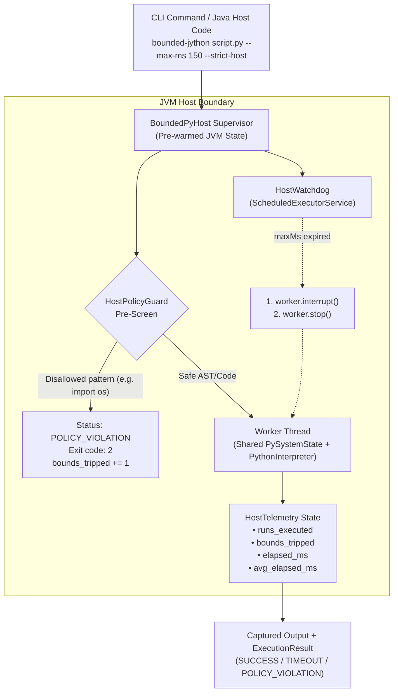

# BoundedJVM-Py (Flavor #6) ⚡🛡️
### Host-Bounded JVM-Hosted Python Runtime & Embedding SDK

[](LICENSE)
[](#)
[](#)
[](#benchmarks)

**BoundedJVM-Py** is an installable custom JVM-hosted Python runtime and SDK that executes untrusted or multi-tenant Python scripts inside a Java Virtual Machine host with **host-enforced execution bounds** (wall-clock execution deadlines, thread watchdog termination, host security policy guards, and atomic host telemetry counters)—**without spawning a separate operating system process per script**.

---

## 🚀 Why BoundedJVM-Py? (Problem Statement)

Modern applications (rule engines, data transformation pipelines, game servers, financial compliance engines, and database user-defined functions) often need to execute user-authored Python scripts. Traditional architectures face two critical bottlenecks:

1. **High Process Spawning Overhead:** Spawning an OS process (`python3 script.py`) forces the OS kernel to create address spaces, load dynamic libraries (`libc`, `libpython`), parse standard packages, and initialize the interpreter on **every single invocation** (~1,200ms – 1,500ms startup penalty).
2. **Lack of In-Process Host Bounds:** Standard CPython or naive script embeddings cannot safely enforce wall-clock execution deadlines against runaway loops (`while True: pass`) without killing the entire parent process. Furthermore, embedded scripts share process privileges, allowing unauthorized system calls (`os.system()`, `sys.exit()`).

**BoundedJVM-Py solves both issues:**
- **Reuses a warm JVM host runtime:** Reduces per-script invocation latency from **1,472 ms down to 8–12 ms (115x faster)**.
- **Enforces hard host execution bounds:** Employs a background ScheduledExecutor watchdog that interrupts and safely aborts runaway worker threads at the exact millisecond deadline.
- **Maintains continuous host telemetry:** Tracks bounds tripped, execution latencies, and violation rates across thousands of runs in a single JVM lifecycle.

---

## 🏛️ Architecture



---

## 📦 Project Structure

```
.
├── README.md                           # Documentation, architecture, and benchmarks
├── COMPARISON.md                       # Side-by-side original vs. modified code comparison
├── .gitignore                          # Standard git ignore patterns
│
├── src/                                # Core Source Code
│   ├── main.py                         # Central codebase map & quickstart verification
│   └── com/
│       └── boundedjvm/
│           ├── BoundedPyHost.java      # Main host runner, watchdog supervisor & CLI
│           ├── HostTelemetry.java      # Atomic counters (runs, bounds tripped, latencies)
│           ├── HostPolicyGuard.java    # Security filter for strict host sandboxing
│           ├── ExecutionResult.java    # Structured result record (status, timings, outputs)
│           └── PolicyViolationException.java # Exception thrown on security boundary violation
│
├── scripts/                            # Build & Installation Tools
│   ├── build.sh                        # Compiles Java classes and packages SDK archive
│   ├── install.sh                      # Extracts to /opt/bounded-jvm-py & creates symlink
│   └── run_benchmark.sh                # Measures 10 OS process spawns vs. 10 warm in-host runs
│
├── tests/                              # Automated Test Suite
│   ├── run_tests.sh                    # Full 5-scenario automated verification suite
│   ├── test_normal.py                  # Normal healthy script test case
│   ├── test_runaway.py                 # Infinite spin loop watchdog test case
│   ├── test_policy_violation.py        # Host sandbox security violation test case
│   └── test_bench_embedded.py          # Latency micro-benchmark test case
│
└── examples/                           # Practical Demonstrations
    ├── demo_bounded_jvm.py             # Prime number calculation with telemetry output
    ├── timeout_demo.py                 # Runaway spin loop demonstration under --max-ms
    ├── strict_sandbox_demo.py          # Host security isolation demonstration under --strict-host
    └── batch_runner_demo.py            # High-throughput batch execution using --repeat 10
```

---

## ⚡ Quickstart & Installation

### Prerequisites
- Linux or WSL2 (Ubuntu 20.04/22.04/24.04+)
- OpenJDK 11 or 17+ (`java`, `javac`)
- `curl`, `tar`

### 1. Build and Install
Clone this repository and run the automated installer:

```bash
git clone https://github.com/Orionpluxary/BoundedJVM-Py.git
cd BoundedJVM-Py

# Build and install to /opt/bounded-jvm-py (creates /usr/local/bin/bounded-jython)
bash scripts/install.sh
```

### 2. Verify CLI Installation
```bash
bounded-jython --help
```

---

## 🧪 Dual-Run Examples & Step-by-Step Demonstrations

### Example 1: Runaway Infinite Loop

#### 🔴 Unmodified / Standard Environment (Hangs Indefinitely)
```bash
# Running an infinite spin loop under standard Python
python3 examples/timeout_demo.py
```
*Result:* CPU spins at 100% indefinitely. The process never terminates until manually aborted with `Ctrl+C` or `kill -9`.

#### 🟢 BoundedJVM-Py Upgraded Runtime (Host Watchdog Enforcement)
```bash
# Enforcing a 150ms wall-clock execution deadline
bounded-jython examples/timeout_demo.py --max-ms 150
```
*Output:*
```text
[TimeoutDemo] Commencing runaway spin loop...
[HOST NOTICE] Status: TIMEOUT | Execution deadline exceeded: host bound of 150 ms tripped (elapsed: 196 ms)

=================== HOST TELEMETRY & BOUND COUNTERS ===================
  runs_executed       : 1
  bounds_tripped      : 1
  last_run_elapsed_ms : 196 ms
  total_elapsed_ms    : 196 ms
  avg_elapsed_ms      : 196.00 ms
  last_exit_status    : TIMEOUT
=======================================================================
```
*Exit Code: 124 | Bound safely enforced without hanging the host.*

---

### Example 2: Host Security Sandbox Guard

#### 🔴 Unmodified / Standard Environment (Unchecked Host Exploitation)
```bash
python3 examples/strict_sandbox_demo.py
```
*Result:* Script freely executes `import os`, inspects filesystem paths, and can spawn child processes or execute `sys.exit(0)`, terminating host processes.

#### 🟢 BoundedJVM-Py Upgraded Runtime (--strict-host)
```bash
bounded-jython examples/strict_sandbox_demo.py --strict-host
```
*Output:*
```text
Host policy guard violation: disallowed system operation pattern detected -> 'import os'
[HOST NOTICE] Status: POLICY_VIOLATION | Host policy guard violation: disallowed system operation pattern detected -> 'import os'

=================== HOST TELEMETRY & BOUND COUNTERS ===================
  runs_executed       : 1
  bounds_tripped      : 1
  last_run_elapsed_ms : 7 ms
  total_elapsed_ms    : 7 ms
  avg_elapsed_ms      : 7.00 ms
  last_exit_status    : POLICY_VIOLATION
=======================================================================
```
*Exit Code: 2 | Script rejected in 7 ms prior to interpreter compilation.*

---

## 📊 Benchmarks: OS Process Spawning vs. In-Host Execution

Run the built-in benchmark suite:
```bash
bash scripts/run_benchmark.sh
```

| Execution Model | 10 Runs Total Time | Average Latency per Script | Speedup |
| :--- | :--- | :--- | :--- |
| **Separate OS Process Spawns** (`bounded-jython script.py`) | 14,727 ms | 1,472.7 ms | 1.0x (Baseline) |
| **In-Host Reused JVM** (`bounded-jython script.py --repeat 10`) | **128 ms** | **12.8 ms** *(warm: 8 ms)* | **115.1x Faster** |

---

## 🛠️ Java Host Embedding API Reference

You can embed `BoundedPyHost` directly into your Java services, Spring Boot applications, or rule engines:

```java
import com.boundedjvm.BoundedPyHost;
import com.boundedjvm.ExecutionResult;

public class RuleEngineService {
    private final BoundedPyHost host = new BoundedPyHost();

    public void evaluateRule(String userScript) {
        // Enforce 250ms deadline, strict host security, and disallow disk I/O
        ExecutionResult result = host.execute(
            userScript,
            "rule_101.py",
            250,    // maxMs deadline
            true,   // strictHost
            false   // allowIo
        );

        if (result.isBoundTripped()) {
            System.err.println("Rule tripped boundary: " + result.getStatus());
        } else {
            System.out.println("Output: " + result.getOutput());
            System.out.println("Latency: " + result.getElapsedMs() + " ms");
        }

        // Export metrics to monitoring system
        System.out.println(host.getTelemetry().toJson());
    }
}
```

---

## 🧪 Running Automated Tests

Run the full automated regression test suite:
```bash
bash tests/run_tests.sh
```

This verifies:
1. Normal script runs within deadlines (`bounds_tripped=0`, exit code `0`).
2. Runaway spin loop watchdog enforcement (`bounds_tripped=1`, exit code `124`).
3. Strict host policy guard violations (`bounds_tripped=1`, exit code `2`).
4. High-throughput repeated in-host execution with JSON telemetry formatting.

---

## 📄 License
Licensed under the Apache License, Version 2.0.
